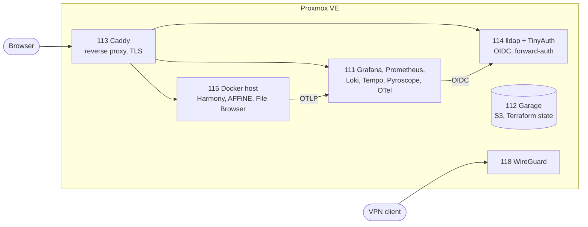

# homelab-iac

[](https://github.com/aBgAmeuR/homelab/actions/workflows/release.yml)
[](LICENSE)
[](renovate.json)

Infrastructure as code for a Proxmox homelab. Terraform provisions the LXC guests, Ansible configures them, and SOPS keeps every secret encrypted in the repository. Guest firewalls drop inbound traffic unless a rule opens a port.

## What it runs



| Layer | Tool |
| --- | --- |
| Hypervisor | Proxmox VE |
| Provisioning | Terraform (`bpg/proxmox`), state in Garage |
| Configuration | Ansible |
| Secrets | SOPS + age |
| Edge | Caddy, TinyAuth (OIDC + forward-auth), lldap, WireGuard |
| Observability | Grafana, Prometheus, Loki, Tempo, Pyroscope, OpenTelemetry Collector |
| Workloads | Docker Compose, Renovate |

## Design choices

- **Split ownership.** Terraform owns the Proxmox object (VMID, resources, NIC, IP, firewall). Ansible owns the software inside it. A drifting guest never causes a container rebuild.
- **Single sign-on.** lldap holds users and TinyAuth acts as the OIDC issuer for Grafana, Proxmox, File Browser and AFFiNE. Each service keeps a local break-glass account.
- **Correlated telemetry.** Harmony sends OTLP to one collector. Traces go to Tempo, logs to Loki, and request metrics are derived from spans. Grafana links a trace to its log lines and back.
- **Closed by default.** Each guest firewall opens only the ports a rule names. Postgres and Redis are not published outside their Compose network.
- **Encrypted secrets in git.** Every `*.sops.*` file is encrypted with age. Terraform state lives in a self-hosted S3 (Garage).
- **Automated releases and updates.** semantic-release tags versions from conventional commits, and Renovate opens dependency PRs.

## Quick start

Prerequisites: Terraform, Ansible, [Task](https://taskfile.dev), [SOPS](https://github.com/getsops/sops), and the age private key at `~/.config/sops/age/keys.txt`.

Some objects are created by hand first (Proxmox API users, DNS, Cloudflare tokens). See [docs/bootstrap.md](docs/bootstrap.md).

```bash
task tf:plan
task tf:apply
task ansible -- playbooks/site.yml
task check
```

## Repository layout

```
terraform/                 guests, firewall, remote state
terraform/modules/lxc      LXC containers from the tfvars map
terraform/modules/firewall cluster, node, and guest firewall
ansible/                   playbooks by domain, roles by software, inventory
docker/monitoring/         observability Compose project (CT 111)
docker/host/               Compose projects on the Docker host (CT 115)
docs/                      documentation
```

## Documentation

| Page | Content |
| --- | --- |
| [Architecture](docs/architecture.md) | Layout, ownership, inventory, playbook order |
| [Bootstrap](docs/bootstrap.md) | Manual steps before the first apply |
| [Operations](docs/operations.md) | Commands and secrets |
| [Auth](docs/auth.md) | lldap, TinyAuth, Proxmox OpenID realm |
| [DNS and DHCP](docs/dns.md) | Blocky, dnsmasq, local records |
| [VPN](docs/vpn.md) | WireGuard, peers |
| [Observability](docs/observability.md) | Signals, dashboards, Harmony telemetry |
| [Harmony](docs/harmony.md) | App, Cloudflare tunnel, image updates |
| [AFFiNE](docs/affine.md) | App, OIDC login, deploy order |
| [Add a user](docs/add-user.md) | Create an lldap user |

## License

[MIT](LICENSE)
